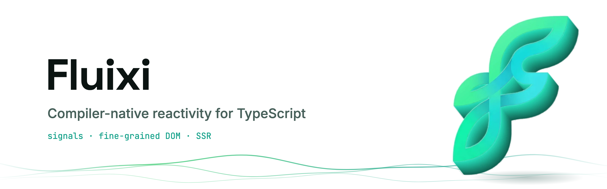

<p align="center">
  <a href="https://fluixi.com">
    <picture>
      <source media="(prefers-color-scheme: dark)" srcset=".github/assets/banner-dark.png" />
      
    </picture>
  </a>
</p>

<p align="center">
  <a href="https://www.npmjs.com/package/@fluixi/core"></a>
  <a href="https://github.com/fluixi/core/actions/workflows/ci.yml"></a>
  
  <a href="./LICENSE"></a>
</p>

<p align="center">
  <a href="https://fluixi.com">Website</a> ·
  <a href="https://docs.fluixi.com">Docs</a> ·
  <a href="https://playground.fluixi.com">Playground</a> ·
  <a href="./examples">Examples</a>
</p>

Fluixi is a compiler-native reactive framework. The compiler knows which values are reactive, so you write ordinary TypeScript and the DOM updates exactly where it changed.

> [!NOTE]
> Fluixi is in alpha. APIs can change between releases, so pin exact versions.

## Why Fluixi

- **Compiler-native.** Reactivity is resolved at build time: no hook rules, no dependency arrays.
- **Fine-grained.** An update touches the text node or attribute that changed. There is no virtual DOM.
- **Small.** A counter app ships about 5.3 KB gzip to the browser.
- **Full-stack.** `@fluixi/start` brings routing, SSR, hydration, API routes and jobs into one app.

## A taste

```tsx
import { signal, memo } from '@fluixi/core';

export function Counter() {
  const count = signal(0);
  const double = memo(() => count() * 2);

  return (
    <button onClick={() => count.set(count() + 1)}>
      {count()} × 2 = {double()}
    </button>
  );
}
```

The compiler binds `{count()}` and `{double()}` to their text nodes. A click re-runs nothing else.

## Quick start

```sh
npm create fluixi@alpha my-app
cd my-app && npm run dev
```

To add Fluixi to an existing Vite app:

```sh
npm i @fluixi/core
npm i -D @fluixi/vite-plugin
```

## Benchmarks

Bundle size of a counter app built with Vite:

| Build | gzip |
| --- | ---: |
| Browser only | 5.3 KB |
| Server-rendered and hydrated | 5.6 KB |
| As a custom element | 8.5 KB |

Keyed rows, compared with Solid (lower is better):

| Scenario | Fluixi | vs Solid |
| --- | ---: | ---: |
| Create 1,000 rows | 32.5 ms | +19% |
| Update one row | 2.6 ms | +4% |
| Update all rows | 12.5 ms | +0.2% |
| Create 10,000 rows | 302.6 ms | +9% |
| Memory after create | 4.1 MB | +22% |

Each scenario ran 40 times.

## Packages

| Package | |
| --- | --- |
| **Core** | |
| [`@fluixi/core`](packages/core) | The framework: components, control flow, context, router and JSX in one import. |
| [`@fluixi/reactive`](packages/reactive) | Signals, memos, effects and stores. No dependencies. |
| [`@fluixi/dom`](packages/dom) | The DOM runtime: fine-grained updates, server rendering and hydration. |
| [`@fluixi/compiler`](packages/compiler) | Compiles JSX and `html` templates to direct DOM calls. |
| **Full-stack** | |
| [`@fluixi/start`](packages/start) | Dev server, builds and the production SSR server. |
| [`@fluixi/router`](packages/router) | URL matching and navigation. |
| [`@fluixi/server`](packages/server) · [`@fluixi/head`](packages/head) | Request-scoped rendering, document head and SEO. |
| [`@fluixi/api`](packages/api) · [`@fluixi/jobs`](packages/jobs) · [`@fluixi/cron`](packages/cron) | Typed API routes, background jobs and schedules. |
| [`@fluixi/auth`](packages/auth) · [`@fluixi/oauth2`](packages/oauth2) · [`@fluixi/session`](packages/session) | Sign-in, OAuth2 and OIDC, sessions. |
| [`@fluixi/realtime`](packages/realtime) · [`@fluixi/storage`](packages/storage) · [`@fluixi/di`](packages/di) | WebSockets, typed storage, dependency injection. |
| **Rendering anywhere** | |
| [`@fluixi/web-components`](packages/web-components) | Publish a component as a standard custom element. |
| [`@fluixi/template-runtime`](packages/template-runtime) · [`@fluixi/cdn`](packages/cdn) | `html` templates without a build step, from a CDN. |
| **Tooling** | |
| [`@fluixi/vite-plugin`](packages/vite-plugin) · [`@fluixi/cli`](packages/cli) · [`create-fluixi`](packages/create) | Vite integration, the `fluixi` command, project scaffolding. |
| [`@fluixi/devtools`](packages/devtools) · [`@fluixi/ts-plugin`](packages/ts-plugin) · [`@fluixi/testing`](packages/testing) | Reactive graph inspector, editor support for templates, test helpers. |

Components live in [fluixi-ui](https://github.com/fluixi/ui), published as `@fluixi-ui/*`.

## Contributing

This is an [Nx](https://nx.dev) and [pnpm](https://pnpm.io) workspace. It needs Node 20 or later and pnpm 10.

```sh
pnpm install
pnpm nx run-many -t build
pnpm nx run-many -t test typecheck
```

Run one package with `pnpm nx <target> @fluixi/<name>`. Add a changeset with `pnpm changeset` before opening a pull request.

## License

[MIT](./LICENSE) © Ibrahima Touré
