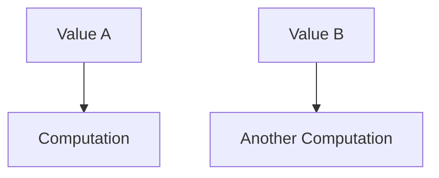

# Beginner Guide

## What Problem Does Reactivity Solve?

Reactivity allows programs to automatically respond to data changes.

Instead of manually updating everything when data changes, you describe *relationships*.

---

## What Makes Fine-Grained Special?

Fine-grained reactivity updates **only what truly depends on changed data**.

